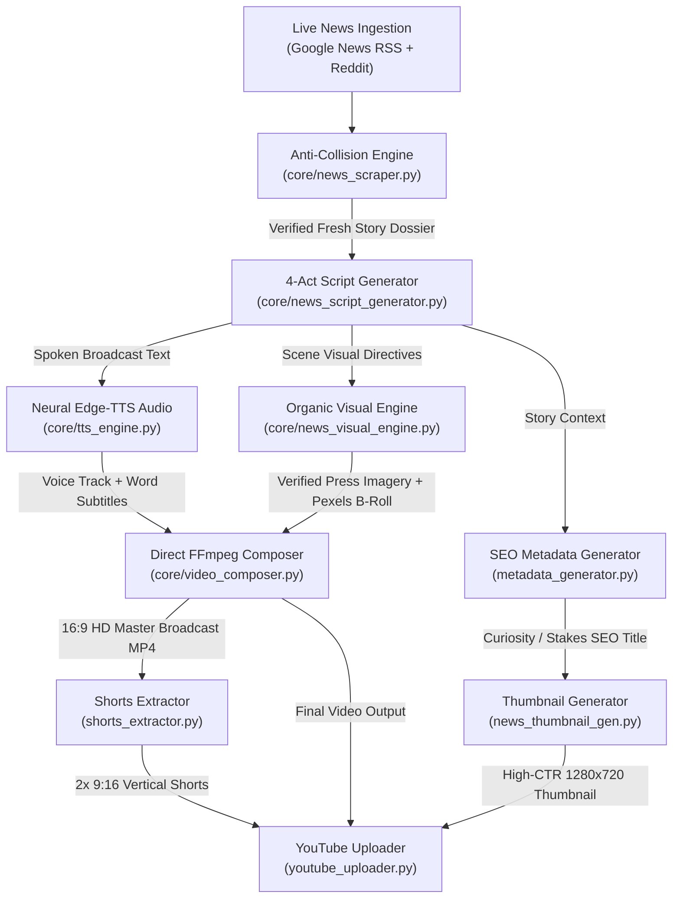

# Global Pulse 24 — Autonomous Video Engine & Channel Architecture

## 🏛️ Project State & Operational Playbook
**Channel Name**: Global Pulse 24  
**Primary Niche**: US Executive Power, Macroeconomic Shocks & Global Geopolitics  
**Target Demographic**: Core US (60%+), Adults 45–65+, high affinity for high-stakes governance, dollar impacts, and global power shifts.  
**Content Strategy**: The "Hub & Spoke" System (1x Long-Form Deep Dive 6–8 mins + 2x Related Shorts 30–50s).

---

## 1. The 4 High-Velocity Pillars

To prevent single-topic fatigue ("Trump on every video") and eliminate low-view commodity news, the engine strictly rotates across 4 core pillars:

| Pillar Key | Topic Focus | Target Keywords / Coverage | Weight in Auto Pool |
| :--- | :--- | :--- | :--- |
| **`power`** | **US Executive & Constitutional Power** | White House executive orders, DOJ/FBI actions, Supreme Court rulings, Congress/Senate power clashes, border and deportation policies. | **35%** |
| **`economy`** | **Macroeconomic Shocks & Dollar Stakes** | US tariffs and trade wars, Federal Reserve interest rates, inflation surprises, oil/energy geopolitics, Wall Street & debt ceiling. | **30%** |
| **`tech_power`** | **Big Tech Hegemony & AI Defense Race** | US-China semiconductor chip bans, Pentagon/military AI contracts (Anthropic, OpenAI, Nvidia), Elon Musk vs regulators, H-1B tech visa restrictions. | **20%** |
| **`geopolitics`** | **Strategic Global Flashpoints** | Flashpoints with direct US stakes: Middle East shipping & oil corridors, Taiwan Strait naval strategy, Russia-NATO trade realignments. | **15%** |

---

## 2. System Architecture & Component Roles



### Core File Responsibilities:
1. **[`news_pipeline.py`](file:///D:/youtube-automation-flows/news-flow/news_pipeline.py)**: Master orchestrator. Handles CLI arguments, auto-category selection, voice/dimension presets, thumbnail coordination, and YouTube publishing.
2. **[`core/news_scraper.py`](file:///D:/youtube-automation-flows/news-flow/core/news_scraper.py)**: Real-time RSS and Reddit news scraper with **Stemmed Entity + 48-Hour Action Cluster Anti-Collision**.
3. **[`core/news_script_generator.py`](file:///D:/youtube-automation-flows/news-flow/core/news_script_generator.py)**: Groq LLM scriptwriter (`qwen/qwen3.8-27b`, `openai/gpt-oss-120b`). Uses a **4-Act narrative structure** for long-form (6–8 min) broadcasts and punchy cold-hook Shorts (45s).
4. **[`core/tts_engine.py`](file:///D:/youtube-automation-flows/news-flow/core/tts_engine.py)**: Neural voice synthesizer (`en-US-ChristopherNeural`) with millisecond word timestamps for burned-in subtitles.
5. **[`core/news_visual_engine.py`](file:///D:/youtube-automation-flows/news-flow/core/news_visual_engine.py)**: Assembles 100% organic, strike-proof visual media:
   - Verified Wikimedia public domain press photos (with strict keyword validation to prevent mismatched politicians).
   - High-contrast newspaper headline highlight cards.
   - Verified official statement / tweet cards.
   - Pexels/Pixabay contextual camera B-roll.
   - Live lower-third broadcast ticker and source attribution badges.
6. **[`core/video_composer.py`](file:///D:/youtube-automation-flows/news-flow/core/video_composer.py)**: Direct FFmpeg streaming compositor. Employs chunk-based rendering for near-zero memory footprint, Ken Burns image motion, and burned-in outline subtitles.
7. **[`news_thumbnail_gen.py`](file:///D:/youtube-automation-flows/news-flow/news_thumbnail_gen.py)**: 1280x720 broadcast thumbnail generator with alpha directional gradients, 3D drop-shadow typography, and **recent thumbnail image history tracking** (`data/thumbnail_history.json`).
8. **[`metadata_generator.py`](file:///D:/youtube-automation-flows/news-flow/metadata_generator.py)**: High-CTR SEO title generator rotating between curiosity gap, stakes/scale, question hook, and list patterns.
9. **[`shorts_extractor.py`](file:///D:/youtube-automation-flows/news-flow/shorts_extractor.py)**: Automatically extracts 30–50 second 9:16 vertical shorts from rendered 16:9 master videos.
10. **[`youtube_uploader.py`](file:///D:/youtube-automation-flows/news-flow/youtube_uploader.py)**: OAuth2 YouTube API client with automated playlist assignment and metadata submission.

---

## 3. Post-Mortem: Previous Failures & Applied Fixes

| Issue Encountered | Root Cause in Legacy Code | Permanent Fix Applied |
| :--- | :--- | :--- |
| **"Trump on every second video"** | `weighted_pool` in `news_pipeline.py` had Trump hardcoded 5 times (50%). | Replaced with the 4 strategic pillars (`power`, `economy`, `tech_power`, `geopolitics`). |
| **4 Duplicate Videos on 9/23 (DOJ/Trump Media Ban)** | `is_story_duplicate()` only checked sequence matching on raw headline text. Different wire phrasing slipped through. | Implemented **Stemmed Entity + Action Cluster deduplication** (`ban`, `tariff`, `sanction`, `subpoena`, `order`, etc.). Any story matching the same entity + action within 48 hours is strictly blocked. |
| **Mismatched Face (Anthony Albanese on Amazon AI)** | Wikipedia fallback search (`srsearch`) blindly accepted the first search result without verifying relevance to the query. | Added strict token validation: search result titles must share keyword tokens with the original entity query before any image is accepted. |
| **Repeated JD Vance / Trump Images** | Single Wikipedia primary portraits were reused indefinitely without history tracking. | Created `data/thumbnail_history.json`. The pipeline now cycles to alternative candidate imagery if a portrait was used in the last 6 thumbnails. |
| **Dry RSS Titles in YouTube Feed** | `news_pipeline.py` line 515 had `meta["title"] = video_title`, overwriting the SEO generator. | Removed the overwrite. Preserves `metadata_generator.py`'s curiosity-gap and stakes-driven titles for both metadata and thumbnails. |

---

## 4. CLI Execution Playbook

### A. Long-Form Investigative Broadcast (6–8 Minutes, 16:9 Landscape)
```powershell
# Executive Power & Governance
python news_pipeline.py --category power --format landscape --duration 360

# Macroeconomic & Tariff Shocks
python news_pipeline.py --category economy --format landscape --duration 360

# Big Tech & Defense/AI Flashpoints
python news_pipeline.py --category tech_power --format landscape --duration 360

# Global Strategic Flashpoints
python news_pipeline.py --category geopolitics --format landscape --duration 360
```

### B. High-Velocity Breaking Short (45 Seconds, 9:16 Vertical)
```powershell
python news_pipeline.py --category power --format shorts --duration 45
```

### C. Manual Query Override (Target Specific Breaking News Event)
```powershell
python news_pipeline.py --query "Federal Reserve interest rate decision emergency" --format landscape --duration 360
```

### D. Full Autonomous Mode (Auto-Select Fresh Story, Render, & Upload)
```powershell
# Upload as Private (recommended for queue review)
python news_pipeline.py --auto-post --upload --privacy private

# Upload Directly as Public
python news_pipeline.py --auto-post --upload --privacy public
```

### E. Extracting Shorts from a Long Video (Hub & Spoke Model)
```powershell
python shorts_extractor.py --video "output\your_video.mp4" --srt "temp\voiceover.srt" --max 2
```
*Tip: When uploading the extracted Shorts to YouTube Studio, use the **"Related Video"** selector to link directly to the full-length video.*

---

## 5. 4-Act Long-Form Script Structure Reference

For reference when modifying [`core/news_script_generator.py`](file:///D:/youtube-automation-flows/news-flow/core/news_script_generator.py):

* **Act 1: The Breaking Flashpoint & Core Tension (Scenes 1–4, ~60–80s)**: Cold hook immediately detailing the executive order, regulatory move, or crisis. No introduction cliches.
* **Act 2: Behind Closed Doors & Power Brokers (Scenes 5–9, ~90–120s)**: Agencies involved, internal divides, statements from leaders, legal briefs, and leaked memos.
* **Act 3: Economic & Geopolitical Shockwaves (Scenes 10–14, ~90–120s)**: Dollar impact, inflation, market shifts, energy corridors, international allies/adversaries reaction.
* **Act 4: The 48-Hour Forecast & What to Watch (Scenes 15–18, ~60–80s)**: Upcoming court hearings, congressional votes, retaliatory measures, and standard broadcast sign-off.
